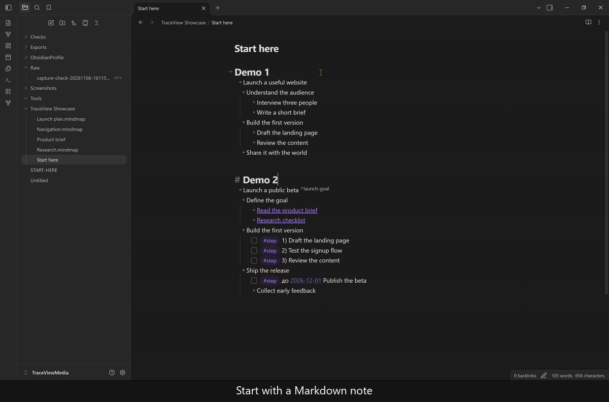
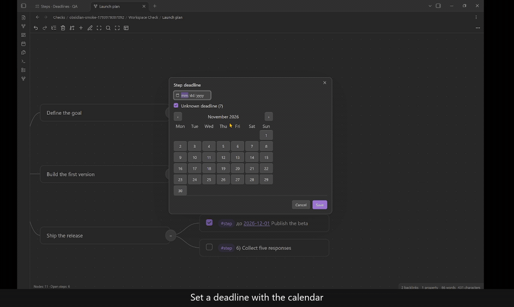
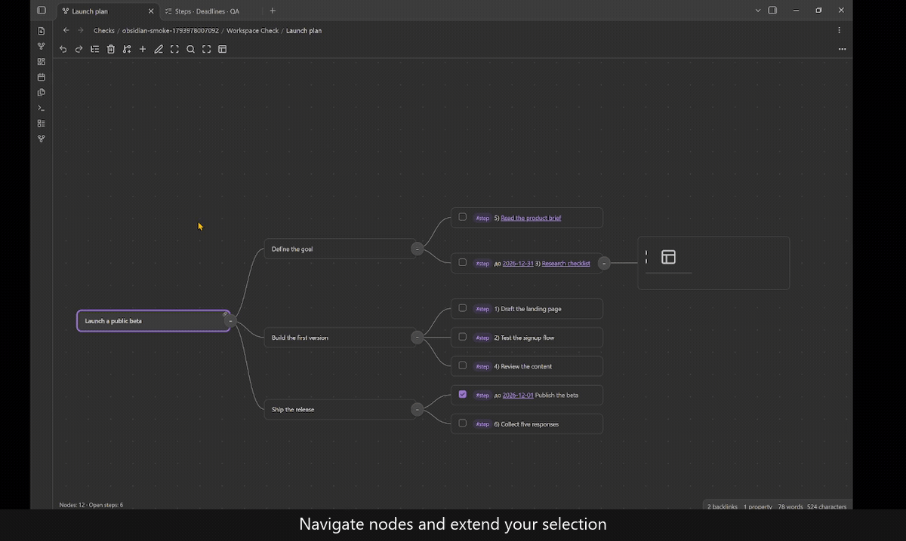
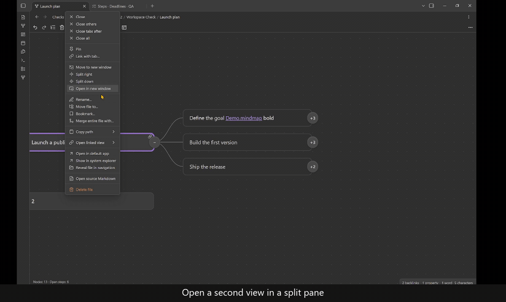
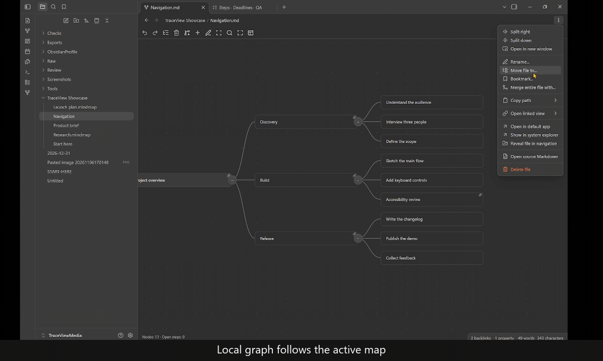
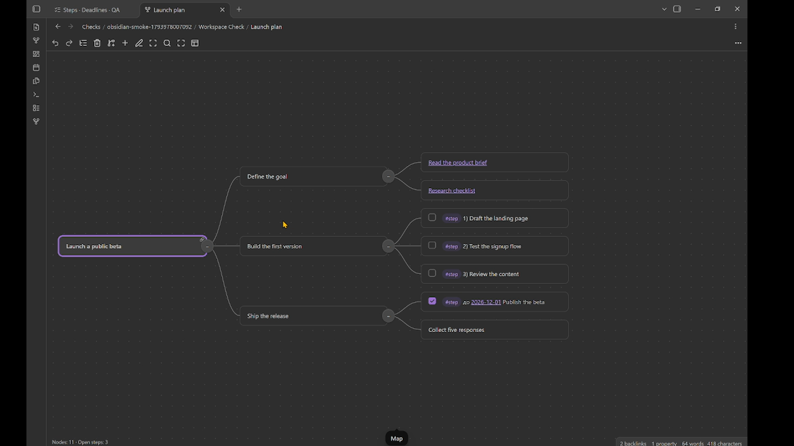
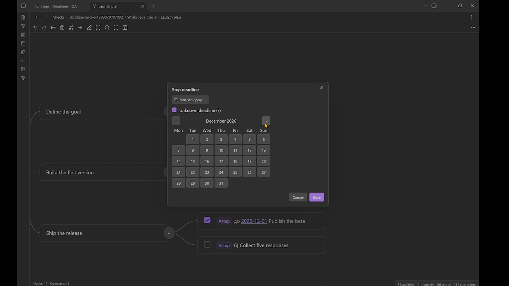
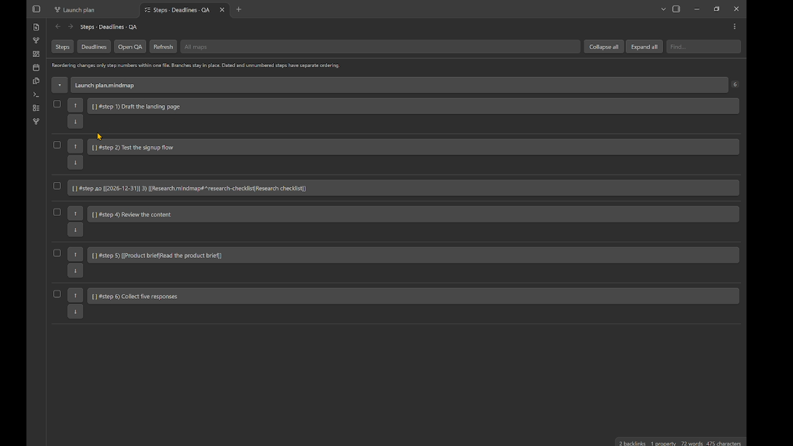
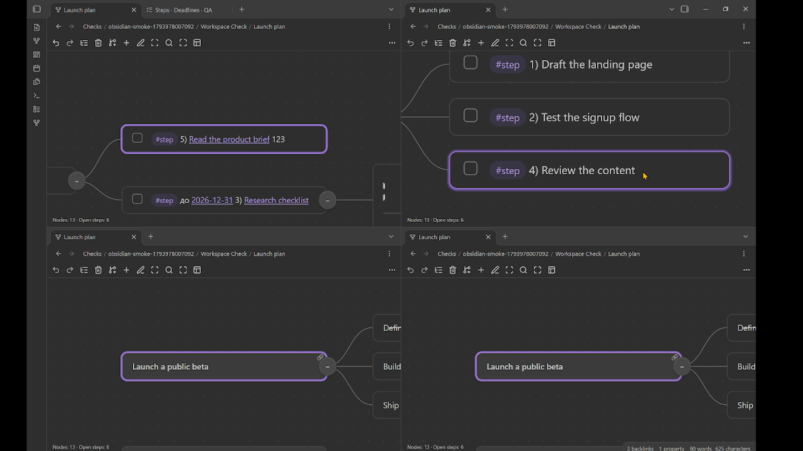
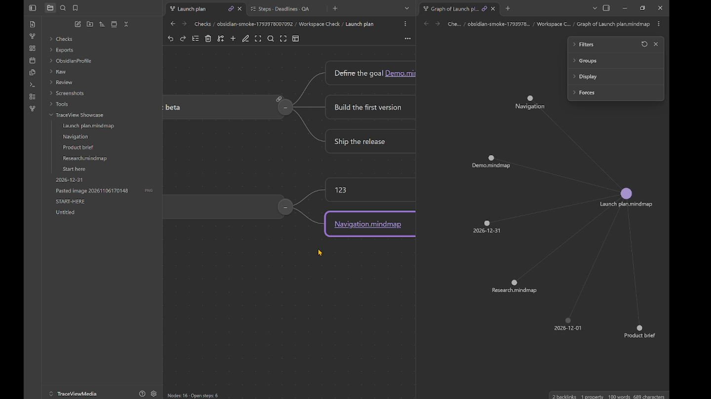

# TraceView Mindmap

Edit Markdown notes as mind maps in Obsidian. Organize ideas into branches, break plans into steps, and follow links between notes and individual nodes.

By **tvoloshaniuk**. Available for desktop and mobile Obsidian.



## License

Copyright (C) 2026 tvoloshaniuk. Original copyrightable project material is
licensed under **GNU GPL version 3 only**, with the **Obsidian Host Additional
Permission** for integration with an independently obtained Obsidian application.
See [LICENSING.md](LICENSING.md), [LICENSE](LICENSE) and
[OBSIDIAN-HOST-PERMISSION.md](OBSIDIAN-HOST-PERMISSION.md) for the complete terms.
Third-party notices and the scope of the licensing review are recorded in
[THIRD-PARTY-NOTICES.md](THIRD-PARTY-NOTICES.md) and [LICENSE-AUDIT.md](LICENSE-AUDIT.md).

## Getting started

1. Open a Markdown note containing headings or a nested list.
2. Run **TraceView Mindmap: Open current note as a map** from the command palette.
3. Select a node. Press **F2** to edit it, **Tab** to add a child, or **Enter** to add a sibling.
4. Use **Open source Markdown** to return to the note in the same tab.

For example, open this note as a map:

```markdown
---
mindmap: true
---
- Project
  - Research
    - [[Background]]
  - Delivery
    - [ ] #step 1) Draft the outline
    - [ ] #step 2) Review the result
```

## See it in action

### Plan with steps and deadlines

Choose a date in the calendar, then review and reorder numbered tasks with the up and down controls in the planning view. Step numbers update in the map too; branches keep their positions.



### Navigate and select nodes

Move between nodes and extend a selection across branches. Arrow keys navigate; Space folds or unfolds the selected branch.



### Work in split panes

Open the same Markdown note in two map views. Saved edits in either pane appear in the other view.



### Follow links between maps and nodes

Obsidian's linked Local graph follows the active map. Copy a link to an individual node, insert it in another map, and follow it back to that node.



### Screenshots











## Editing and navigation

- Edit existing, child, sibling and parent nodes directly in the map. Enter saves, Escape cancels an unchanged draft or asks before discarding changes.
- Arrow keys navigate nodes. Space folds a branch. Folds, camera position and layout are remembered on each device.
- Copy, cut and paste entire branches. Undo and redo cover changes made during the current map session.
- Select multiple nodes using keyboard ranges, modified clicks or the selection tool. Move branches together with their children.
- On desktop, drag a branch by holding the second press of a double-click. On touch screens, hold a node before dragging. The target indicator shows insertion before, after or inside a node.
- Create nodes using the handles around a selected node. Pan and zoom while editing.
- Search within a map, including collapsed branches. Confirm a result to navigate to it.
- Switch between map, outline and table layouts and choose how node widths are calculated.

Configure shortcuts in the plugin settings. Standard text editing shortcuts apply while entering node text.

## Links, attachments and planning

Use Obsidian links, aliases and links to notes that have not been created yet. **Copy link to node** creates a block address when needed. Links such as `[[Plan#^node-id]]` can open a specific node, unfolding its ancestor path while preserving neighbouring branches.

The native node editor provides Obsidian Live Preview and suggestions. A text editor is also available. Paste clipboard images while editing, or use the mobile attachment toolbar. Image files are stored as vault attachments.

The **Steps, deadlines and QA** command opens a planning view. Mark nodes as numbered steps, set dates with the calendar, toggle completion, and review questions. Lists can be filtered by map and text. Step ordering changes numbered, undated steps within their file.

HTML and SVG exports are available from the map actions menu. HTML exports include a folding outline and retain Markdown labels.

## Automatic opening

Enable **Automatically open matching notes as maps** in settings. Filename recognition defaults to:

```text
*.mindmap.md
🎯*.md
```

Choose glob or regex, with one pattern per line. Any matching rule qualifies the note.

- A glob without `/` matches file names in any folder. A glob containing `/` matches the path relative to the vault.
- `*` matches within a path segment, `**` spans folders and `?` matches one character. For example, `Plans/**/*.md` includes Markdown files directly in Plans and its subfolders.
- Regex rules match vault-relative paths. Enter the expression without surrounding `/` delimiters.
- Matching ignores case and applies to Markdown files. Synchronization-conflict copies are excluded.

The `mindmap: true` property also identifies a map. Invalid patterns keep the last saved rules active. Automatic opening, map search and planning lists share these rules. Explicitly opening source Markdown keeps that note in Markdown mode until you choose to open it as a map again.

The pattern field uses the full settings width. **Restore default patterns** resets the filename rules and switches their syntax to glob. **Restore default settings** at the top of the settings page resets all plugin preferences and custom shortcuts after confirmation. Local view states and saved notes are retained. Restart Obsidian to apply a reset language preference.

## Languages

English, Ukrainian, Russian, Polish, German, Spanish, French, Brazilian Portuguese, Simplified Chinese, Japanese and Korean are included. **Automatic (Obsidian)** follows the app language, with English fallback. Restart Obsidian after changing the language setting.

Language dictionaries are in `src/locales`. Initial translations welcome review by native speakers.

## Installation and building

For a manual installation, copy the contents of `release/traceview-mindmap/`, including its licensing documents, into `<vault>/.obsidian/plugins/traceview-mindmap/`, then enable **TraceView Mindmap** in Community plugins. For upgrades, replace the packaged files and keep `data.json`. The three runtime files are `main.js`, `manifest.json` and `styles.css`; licensing text also accompanies `main.js` for Community directory installations.

To build from source with Node.js and npm:

```sh
npm ci
npm run package
npm test
```

Installable files are written to `release/traceview-mindmap/`. The minimum declared Obsidian version is 1.8.7.

`npm run audit:licenses` reproduces the build composition and notice checks. When distributing compiled releases, provide their complete Corresponding Source and build scripts at the matching source tag with equivalent access alongside the binaries.

## Current limitations

- Structural editing preserves Markdown heading and list semantics. Operations that would discard paragraphs, code blocks or ambiguous mixed structure require editing source Markdown.
- Node text is single-line. More content can be placed in child nodes or linked notes.
- Unconfirmed drafts and Undo history do not survive an app restart. Save a node before leaving the app. Discard confirmation currently focuses the discard action.
- Native editing uses an internal Obsidian editor implementation. If unavailable, the plugin falls back to text input. Commands requiring a complete Markdown view should be run in source Markdown.
- The stored deadline marker currently uses the literal `до`, independently of the interface language. Use **Set date** to manage it.
- An empty note needs an initial heading or list item in source Markdown before map editing.
- Large restored maps on Windows wait for a quiet startup period before rendering. **Open now** bypasses that wait.
- Desktop integration has been checked with Obsidian 1.15.0. Physical Android verification and native-speaker translation review remain manual.

## Data

Edits are stored in the original Markdown file. View state is stored locally per vault and device. The plugin does not add analytics or make its own network requests. Obsidian and other enabled plugins can render linked or embedded content using their own behaviour.
